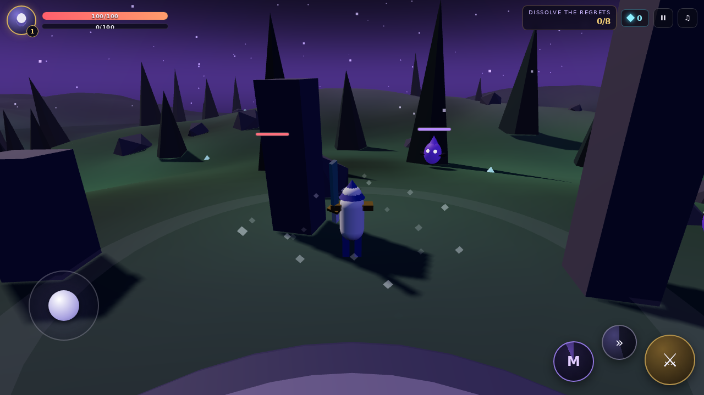

# METANOIA

A 3D action-RPG vertical slice for phones and desktop. Hunt the Regrets, level up,
and achieve metanoia. Built with Three.js + Vite, wrapped for Android with Capacitor —
**no server, no database, no cost.**



## Play it on your phone

You have two free options, both generated automatically from this repository:

### 1. Install the Android app (APK)

1. Push this repo to GitHub (see below) — the **Build APK & Publish Pages** workflow
   starts automatically on every push.
2. Open the repo on GitHub → **Actions** → wait for the green check → open the run →
   download the **METANOIA-apk** artifact.
3. On your phone: open the downloaded `.apk` and allow "Install unknown apps" for
   your file manager/browser when prompted.

The APK carries the proper METANOIA launcher icon and splash screen, and runs fully
offline — no internet needed after install.

### 2. Install it as a web app (PWA)

After the first push, enable it once: repo **Settings → Pages → Source: GitHub Actions**.
The workflow then publishes to `https://<user>.github.io/<repo>/` on every push.
Open that URL on your phone → browser menu → **Add to Home screen** → it launches
fullscreen like a native app.

## Push this project to your GitHub

```bash
git remote add origin https://github.com/<your-user>/<your-repo>.git
git push -u origin HEAD
```

That single push triggers both the APK build and the web deploy.

## Develop locally

```bash
npm ci
npm run dev        # http://localhost:3000
npm run build      # production bundle in dist/
```

Runtime smoke test (optional, needs Playwright and a running dev server):

```bash
npm i -D playwright && npx playwright install chromium
node smoke.mjs
```

## Build the Android app yourself

Requires JDK 21 and the Android SDK.

```bash
npm run build
npx cap sync android
cd android && ./gradlew assembleDebug
# APK: android/app/build/outputs/apk/debug/app-debug.apk
```

Regenerate launcher icons/splash after changing `public/icon.svg`:

```bash
npx capacitor-assets generate --android
```

## Controls

| Input | Action |
| --- | --- |
| WASD / left stick | Move |
| Drag / right side of screen | Camera |
| Click or J | Attack combo |
| Shift | Dash (i-frames) |
| K | Metanoia Burst |
| Space | Jump |
| Esc / P | Pause |

## Project layout

```
src/            game code (world, player, combat, UI, state)
android/        Capacitor-generated Android project
assets/         source icon used to generate Android icons
public/         PWA manifest + web icon
.github/        CI: APK build + Pages deploy
smoke.mjs       headless browser smoke test
```

All art, terrain and sound are generated procedurally at runtime — the repo ships
no binary game assets, so it stays tiny and fast.
